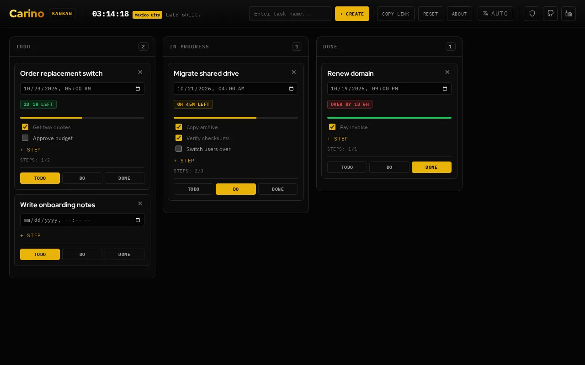

# Kanban

A three-column task board (to do, in progress, done) that keeps the whole board in its own link, so a bookmark saves it and a link shares it.

**[Open it →](https://kanban.carino.systems/)** — runs in your browser, nothing to install, no account.

## What it does

- Three columns: To do, In progress, Done. Move a card by dragging it, or with the TODO / DO / DONE buttons on the card, which also work on touch screens.
- Give a card an optional deadline and it shows a countdown: green while on track, amber in the last two hours, red with "over by …" once it is late.
- Split a card into checklist steps; a progress bar fills as you tick them off.
- Card titles and steps are edited in place, by clicking on them.
- Copy Link puts the current board on your clipboard. Reset asks for a second click before it clears anything.
- Interface in English, Spanish, Portuguese (Brazil), Japanese and Russian.

There is no server and no database. Every change is written into the part of the link after `#`, which browsers do not send to the web server, and a backup copy is kept in this browser's local storage. Anyone you send the link to can read the board.

## Licensing

**Mine — GNU Affero General Public License v3.0 or later.** Everything in this
repository *except* the paths listed below. Copyright © 2026 Miguel Carino.
Full terms in [LICENSE](LICENSE).

**Not mine.** The files below are third-party works redistributed here. This
project's licence does not cover them and could not: they are not mine to
relicense. Each keeps its own terms, and each carries its own notice.

| Path | What it is | Licence | Notice |
| --- | --- | --- | --- |
| [`fonts/`](fonts/) | IBM Plex Mono, IBM Plex Sans, Red Hat Display | SIL OFL 1.1 | [`fonts/OFL.txt`](fonts/OFL.txt) |

Those files travel with any fork, mirror or repackaging of this repository, and
their notices must travel with them.
